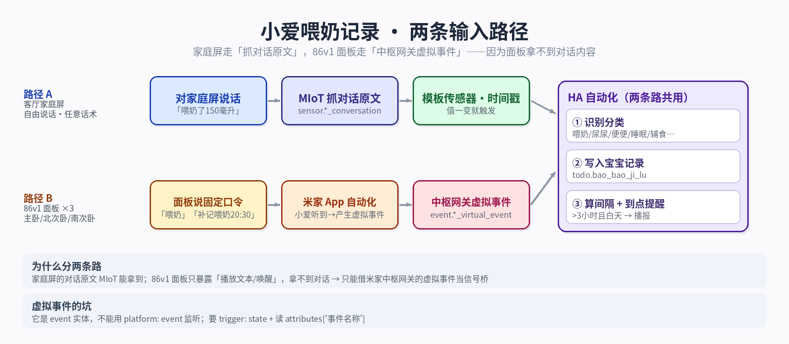

# ha-voice-baby-note

> 对小爱说一句话，Home Assistant 自动记下育儿数据；到点还会主动提醒你该喂奶了。
>
> **零 App、零手动输入、纯语音。**

---

## 这是什么

半夜喂奶手忙脚乱，谁还记得刚才几点喂的、喂了多少？

这套系统让你**说一句话就完事**：

```
你：  「喂奶一百二」
小爱：「好的」
      ↓
HA 自动在「宝宝记录」里写一条：
      10-07 03:15 🍼 喂奶 120ml｜喂奶一百二
```

还可以：

```
你：  「补记喂奶 20:30」      → 补一条当天 20:30 的记录（只允许当天）
你：  「上次什么时候喂的」     → 就近的小爱播报答案
自动：距上次喂奶超过 3 小时 且 在 7:00–22:00  → 主动播报提醒
```

**所有记录都在 HA 的「待办清单」里**，手机、平板、家庭屏都能看。

---

## 架构



两条语音入口，一套记录逻辑：

```
┌─────────────────┐         ┌──────────────────────┐
│ 小爱家庭屏       │         │ 86 智能面板（卧室）    │
│ （自由说话）      │         │ （固定口令）           │
└────────┬────────┘         └──────────┬───────────┘
         │                             │
         │ Xiaomi MIoT                 │ 米家自动化
         │ sensor.*_conversation       │ → 中枢网关虚拟事件
         │                             │ event.*_virtual_event_*
         ▼                             ▼
┌─────────────────────────────────────────────────────┐
│              Home Assistant 自动化                    │
│  ① 自由说话：监听对话传感器（带去重 + 问句过滤）        │
│  ② 面板口令：监听虚拟事件属性「事件名称」               │
│  ③ 喂奶计时器：更新 input_datetime                    │
│  ④ 到点提醒：超阈值 + 时段判断 → 就近播报              │
│  ⑤ 补记：写 input_datetime → 脚本 → 清单              │
│  ⑥ 查询：读清单 → 组话术 → 就近播报                    │
└────────────────────────┬────────────────────────────┘
                         ▼
              ┌──────────────────────┐
              │  todo.bao_bao_ji_lu  │  ← 用待办清单当数据库
              │  （宝宝记录）          │
              └──────────────────────┘
```

---

## 功能清单

| # | 功能 | 触发方式 |
|---|---|---|
| F1 | 自由说话记录 | 对家庭屏说「喂奶一百二」|
| F2 | 固定口令记录 | 对 86 面板说「喂奶」|
| F3 | 补记（仅当天）| 说「补记喂奶 20:30」或按按钮 |
| F4 | 查询上次 | 说「上次什么时候喂的」→ 就近播报 |
| F5 | 到点提醒 | 超阈值自动播报（白天才响）|
| F6 | 全部记录可查 | HA 待办清单 |

支持记录的类别：**喂奶 / 辅食 / 喝水 / 换尿布 / 大便**（可扩展）。

---

## 前置条件

### 硬件

| 设备 | 必需 | 作用 |
|---|---|---|
| Home Assistant | ✅ | 大脑 |
| 小爱家庭屏（带屏音箱）| ✅ | **语音入口 + 播报出口**（唯一能拿到「对话原文」的设备）|
| 86 智能面板 | ⭕ | 卧室语音入口（需配中枢网关）|
| 小米中枢网关 | ⭕ | **用 86 面板才需要**，提供「虚拟事件」|
| 手机 | ⭕ | 收通知（可选）|

### 集成

| 集成 | 必需 | 作用 |
|---|---|---|
| **Xiaomi MIoT**（HACS 第三方）| ✅ | 把家庭屏对话原文暴露成 `sensor.*_conversation` |
| **Xiaomi Home**（小米官方）| ✅ | 提供 `notify.*_play_text`（播报）|
| Mobile App | ⭕ | 手机推送 |

> ⚠️ **没有 Xiaomi MIoT，自由说话这条路完全用不了。**
> 因为它依赖一个「对话原文」传感器，官方集成不提供。

---

## 快速开始

### 🚀 方法一：让 AI 帮你搭（推荐）

如果你用 Claude / GPT / DSH 这类 AI Agent，**只需要给它一份 `agent.md`**：

```
把这个仓库的 agent.md 发给你的 AI，它就能按步骤在
你的 Home Assistant 上从零搭起来。
```

`agent.md` 里包含：
- 必须向用户收集的信息清单（占位符）
- 每一步的验证命令
- 常见失败模式
- 敏感信息替换规则
- 交付检查表

### 方法二：手动搭建

按顺序做：

```
1. 装集成
   - HACS 装 Xiaomi MIoT → 重启 → 添加集成
   - 添加 Xiaomi Home 集成
   - 验证：存在 sensor.*_conversation 和 notify.*_play_text

2. 建辅助实体
   - input_datetime.wei_nai_shi_jian（上次喂奶时间）
   - todo.bao_bao_ji_lu（宝宝记录清单）
   - 4 个模板助手（见 ha/helpers.md）

3. 合并 YAML
   - ha/configuration.template.yaml → configuration.yaml
   - ha/automations.template.yaml   → automations.yaml
   - ha/scripts.template.yaml       → scripts.yaml
   - 替换所有 YOUR_XXX_ID 占位符

4. 重启 HA，按 docs/实现说明.md 的「验收清单」逐项测试
```

---

## 文件说明

| 文件 | 说明 |
|---|---|
| **`agent.md`** | ⭐ **AI 构建指南** —— 丢给 AI Agent 就能自动搭建 |
| `README.md` | 本文件 |
| `docs/实现说明.md` | **详细实现说明**（528 行）：为什么这么设计、5 条链路、踩过的坑 |
| `ha/configuration.template.yaml` | `input_datetime` + 模板传感器 |
| `ha/automations.template.yaml` | 5 条自动化（含面板口令、计时器、提醒、查询）|
| `ha/scripts.template.yaml` | 补记脚本 |
| `ha/helpers.md` | 4 个 UI 模板助手的配置 |
| `images/architecture.png` | 架构图 |

---

## 六条链路

详细说明见 [`docs/实现说明.md`](docs/实现说明.md)。

| 链路 | 触发 | 关键点 |
|---|---|---|
| **1. 自由说话** | 家庭屏对话传感器变化 | 必须**过滤问句**，否则「什么时候喂的」会被误记成一次喂奶 |
| **1-B. 面板口令** | 86 面板 → 米家 → 中枢虚拟事件 | `event` 域实体**不能用 `platform: event`** 监听，要监听状态 + 读 `attributes['事件名称']` |
| **2. 喂奶计时器** | 喂奶类事件 | 静默更新 `last_triggered`，作为「距上次多久」的持久状态 |
| **3. 到点提醒** | 每 5 分钟轮询 | 超阈值 + 时段 + 冷却时间，三重条件 |
| **4. 补记** | 语音 / 按钮 | **只允许当天**，防止误补历史 |
| **5. 查询** | 语音问句 | 读清单 → 组话术 → 就近播报 |

---

## 踩过的坑（精华）

### ❶ `event` 域实体不能用 `platform: event` 监听

```yaml
# ❌ 这样收不到任何事件
trigger:
  - platform: event
    event_type: xiaomi_cn_XXX_hub1_virtual_event_e_4_1

# ✅ 正确：监听状态变化，再读属性
trigger:
  - trigger: state
    entity_id: event.xiaomi_cn_XXX_hub1_virtual_event_e_4_1
conditions:
  - condition: template
    value_template: "{{ '喂奶' in state_attr('event.xiaomi_cn_XXX_hub1_virtual_event_e_4_1','事件名称') }}"
```

### ❷ 直接监听对话传感器会重复触发

必须用「时间戳」判断这条对话是否已处理过，否则一次说话会记录好几遍。

### ❸ 一定要过滤问句

`什么时候` / `多久` / `几点` / `上次` / `?` …… 这些是**查询**，不是**记录**。

### ❹ 用 `todo` 当数据库特别好用

- 自带界面（HA 待办清单卡片）
- 自带 ICS 导出
- 增删改查都有现成 service
- 不需要自己写存储逻辑

更多坑见 [`docs/实现说明.md`](docs/实现说明.md#五踩过的坑关键)。

---

## 验证清单

搭完后逐项测：

- [ ] 说「喂奶一百二」→ 5 秒内清单出现 `MM-DD HH:MM 🍼 喂奶 120ml｜喂奶一百二`
- [ ] 连说两次同一句 → **不会重复记录**
- [ ] 说「上次什么时候喂的」→ **不会**被记成一次喂奶，且会播报答案
- [ ] 补记非当天时间 → **被拒绝**
- [ ] 距上次喂奶超 3 小时且在 7:00–22:00 → 自动播报

---

## 常见问题

**Q：没有家庭屏，只有普通小爱音箱能用吗？**

A：不行。普通小爱音箱**不提供对话原文**，只有带屏的家庭屏才行（因为要实现「看懂用户在说什么」）。

**Q：没有 86 面板能用吗？**

A：可以。只走「链路 1 自由说话」，跳过面板相关配置。

**Q：用官方 Xiaomi Home 集成不行吗？**

A：**必须装 HACS 的 Xiaomi MIoT**。官方集成只提供播报，不提供对话原文。

**Q：记录存在哪？**

A：存在 `todo.bao_bao_ji_lu`（本地待办清单），数据在 `.storage/local_todo.bao_bao_ji_lu.ics`。

**Q：能同步到美柚之类的 App 吗？**

A：可以自己做（有 ICS 导出），但本仓库不包含这部分。

---

## 目录结构

```
ha-voice-baby-note/
├── README.md                          # 本文件
├── agent.md                           # ⭐ AI 构建指南
├── LICENSE
├── docs/
│   └── 实现说明.md                     # 详细实现文档
├── ha/
│   ├── configuration.template.yaml    # input_datetime + 模板传感器
│   ├── automations.template.yaml      # 5 条自动化
│   ├── scripts.template.yaml          # 补记脚本
│   └── helpers.md                     # UI 模板助手
└── images/
    └── architecture.png               # 架构图
```

---

## License

[MIT](LICENSE)
